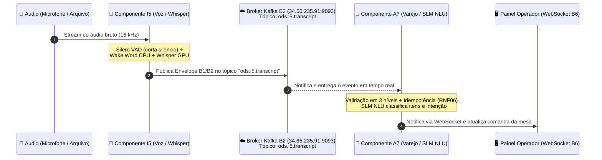

# Guia de Arquitetura e Execução: Integração Kafka entre I5 (Voz) e A7 (Varejo)

**Disciplina:** Oficina de Desenvolvimento de Software (ODS) - UFSJ  
**Squad:** VER-4 (Varejo & Voz)  
**Integração:** B2 (Transporte de Eventos via Barramento Kafka)  

---

## 1. O que é o Kafka e por que estamos usando?

Antes da integração com o Kafka, a comunicação entre os módulos era manual ou baseada em arquivos:
1. O componente **I5** transcrevia o áudio e gerava arquivos `.json` na pasta local `i5/jsons_gerados/`.
2. Para testar o **A7**, era necessário copiar manualmente esses arquivos para a pasta `a7/jsons_gerados copy/`.

**Com o Kafka, eliminamos a troca manual de arquivos!** O Apache Kafka atua como um **barramento de eventos distribuído e em tempo real** (Pub/Sub na nuvem):
- O componente **I5** publica transcrições assim que o Whisper termina de processar cada fala.
- O componente **A7** escuta esse canal e recebe a transcrição na mesma fração de segundo, classificando a intenção no SLM (`llama3.2-varejo`) e atualizando a comanda da mesa.

---

## 2. Diagrama de Fluxo (B1/B2)



---

## 3. Os 3 Papéis na Arquitetura

### 1. O Servidor Central (Broker Kafka — Nuvem GCP)
* **Endereço:** `34.66.235.91:9093`
* **Gerenciado por:** Squad de Transporte/Infra (Squad TRA-1).
* **Tópico Utilizado:** `ods.i5.transcript`
* **Como funciona:** O servidor gerencia filas persistentes e particionadas. Ele armazena as mensagens temporariamente e garante entrega rápida aos consumidores inscritos.

### 2. O Produtor (Componente I5)
* **Arquivo:** `i5/src/kafka_publisher.py` (desenvolvido pela Ester e integrado com o pipeline).
* **Função:** Sempre que um bloco de voz é transcrito, empacota o envelope formal B1/B2 em JSON UTF-8:
  ```json
  {
    "message_id": "c1f7a4d2-...",
    "message_type": "event",
    "schema": "ods.i5.transcript",
    "schema_version": "1.0",
    "producer": "I5",
    "occurred_at": "2026-11-05T00:15:00Z",
    "payload": {
      "origem": "mic_mesa_01",
      "texto_transcrito": "quero dois x-saladas",
      "confianca_geral": 0.95,
      "uncertain": false,
      "duvida_explicita": false
    }
  }
  ```
* **Comando para executar:**
  ```bash
  cd i5
  .venv/bin/python3 src/pipeline.py data/audio6.ogg --publish-kafka
  ```

### 3. O Consumidor (Componente A7)
* **Arquivo:** `a7/src/modulo_nlu/kafka_consumer.py` e integração no `main.py`.
* **Função:**
  1. Conecta-se ao broker com o Consumer Group `a7-varejo-nlu`.
  2. Valida o envelope em 3 níveis (campos obrigatórios, metadados do I5 e payload com confiança).
  3. **Idempotência (RNF06):** Verifica o `message_id`. Se a mensagem já foi processada (retransmissão de rede), não adiciona itens duplicados no carrinho.
  4. **Tratamento de Incerteza (RF07):** Se `uncertain == True` ou a confiança for baixa, marca a intenção como `INDETERMINADO` e põe a sessão em `PENDING`, evitando adicionar lanches errados silenciosamente.
  5. Aciona o `SLMIntentClassifier` (`llama3.2-varejo` via Ollama) para extrair os produtos e atualizar a comanda no `SessionManager`.
* **Comando para executar:**
  ```bash
  cd a7
  .venv/bin/python3 main.py --kafka
  ```

---

## 4. Como Executar os Dois Componentes Lado a Lado (Passo a Passo)

Abra dois terminais no seu ambiente:

### Terminal 1: Iniciar o A7 (Consumidor)
Certifique-se de que o Ollama está ativo para inferência com o modelo local:
```bash
# Iniciar o Ollama em segundo plano (caso ainda não esteja rodando)
sudo systemctl start ollama

# Entrar no diretório do A7 e iniciar o modo Kafka
cd /home/mateus/Documentos/UFSJ/ODS/a7
.venv/bin/python3 main.py --kafka
```
*O terminal exibirá:*
```text
==================================================
   [A7 - Kafka B2] Escutando Eventos do I5
   Broker  : 34.66.235.91:9093
   Tópico  : ods.i5.transcript
   Group ID: a7-varejo-nlu
   (Pressione Ctrl+C para encerrar)
==================================================
```

### Terminal 2: Iniciar o I5 (Produtor)
Envie um áudio de teste para o pipeline transcrever e publicar:
```bash
cd /home/mateus/Documentos/UFSJ/ODS/i5
.venv/bin/python3 src/pipeline.py data/audio6.ogg --publish-kafka
```

### O que você observará:
1. No **Terminal 2 (I5)**, o Silero VAD segmentará a fala e o Whisper fará a transcrição. Cada frase gerará a mensagem:
   `[I5 - Kafka] Evento entregue em ods.i5.transcript [partição X @ offset Y]`.
2. No **Terminal 1 (A7)**, no mesmo instante, o evento brotará na tela:
   ```text
   [MIC_BALCAO_1] (msg_id=c1f7a4d2...) Texto: "eu quero um x-bacon e uma coca-cola"
     -> NLU: Intenção=ADICIONAR_ITEM | Confiança Áudio=0.95 | Método=SLM_OLLAMA
     -> Itens Extraídos: [{'produto_id': 2, 'nome': 'X-Bacon', 'quantidade': 1}, {'produto_id': 6, 'nome': 'Coca-Cola Lata 350ml', 'quantidade': 1}]
     -> Jornada [ACTIVE]: Item(ns) adicionado(s): 1x X-Bacon, 1x Coca-Cola Lata 350ml.
     -> Total Comanda (mic_balcao_1): R$ 33.00
   ```

---

## 5. Nota sobre Dependências no Ambiente Virtual (`.venv`)

Se você precisar usar o `pip` diretamente no terminal para o A7 ou I5:
- Os caminhos internos do ambiente virtual foram normalizados para `/home/mateus/Documentos/UFSJ/ODS/a7` e `.../i5`.
- Para ativar o venv na sua sessão de terminal atual:
  ```bash
  source /home/mateus/Documentos/UFSJ/ODS/a7/.venv/bin/activate
  ```
- O pacote `confluent-kafka` (versão 2.16.0) já se encontra instalado e verificado tanto no ambiente do **I5** quanto no do **A7**.

